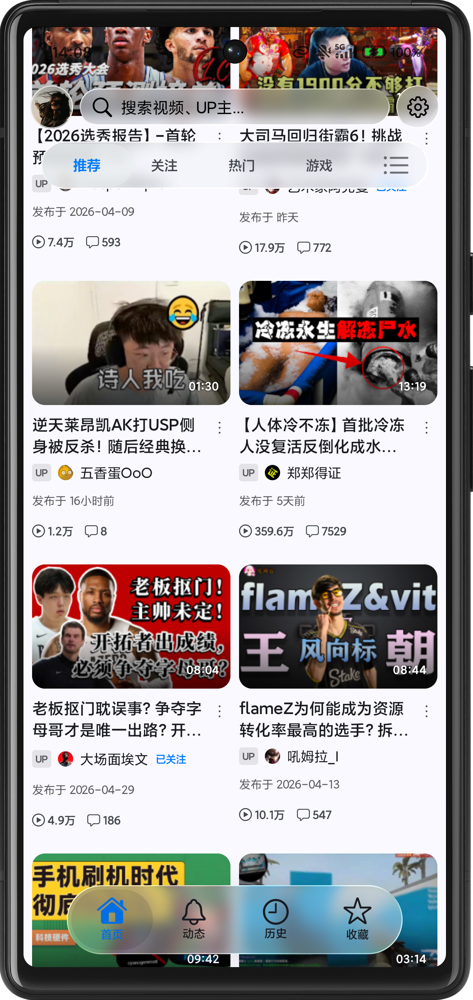
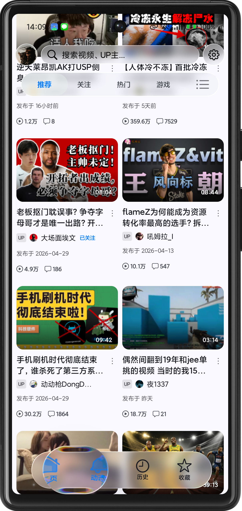

# BiliPai Remastered

> **把“能用”推进到“愿意长期用”。**<br>
> 这是一版围绕播放器状态、弹幕连续性、听视频体验、滚动性能和上游可复现性重做的 BiliPai。

[](https://github.com/joeyl3526-cloud/Bilipai-Remastered)
[](#构建)
[](LICENSE)

## Remastered 的判断

第三方客户端最难的从来不是“把页面做出来”，而是让复杂播放状态在几十次操作后仍然可信：

- 竖屏视频到底该全屏、裁切还是回到详情页？
- 暂停、缓冲、周期校时后，屏幕上的弹幕为什么要被清空？
- 切 Tab、切后台、进 PiP，播放器尺寸和生命周期为什么各自为政？
- 毛玻璃很漂亮，但滑动时为什么掉帧？
- 每次上游发布新版本，几十个本地改动为什么只能人工凭记忆重放？

**BiliPai Remastered 的创新，不在于多写几个页面，而在于把这些行为沉淀成明确的状态策略、性能预算和可复现规则。**

当前版本由 [@joeyl3526-cloud](https://github.com/joeyl3526-cloud) 在 BiliPai 上游基础上完成长期定制。它不是零散修补集合，而是一套经过多轮真机反馈、构建验证和上游迁移后形成的使用体验方案。

## 核心创新

### 1. 重新定义竖屏视频详情页

Remastered 没有继续复制 Story 式竖屏播放器，而是把视频详情页本身做成一套稳定的空间协议：

- 手机竖屏下，播放器初始占约 70% 屏高；
- 视频按比例 FIT 居中，横竖内容都保留对称黑边；
- 上滑跟手收缩，最低收到 16:9；
- 切 Tab 不重置当前折叠状态；
- Tab 行固定并带清晰分割线；
- 弹幕覆盖完整播放器容器；
- 竖屏视频不再触发不可控全屏路径。

这解决了原版“打开竖屏视频就进入一个割裂页面、返回与评论浏览成本极高”的核心痛点。

### 2. 弹幕 Soft Resync：恢复播放不等于清空画面

弹幕引擎的时间同步与数据生命周期被拆开：

- 暂停后恢复：保留屏幕弹幕，只继续时钟；
- 缓冲恢复：原地继续，不重建数据；
- 周期漂移校正：重定引擎时钟，不 `clear + setData`；
- 只有 seek、切集、关闭开关等真正的时间线跳变才硬清屏。

这是对“弹幕一暂停就消失”这个长期痛点的根治式修复。

### 3. 播放状态与系统能力联动

Remastered 对播放器生命周期做了策略化处理：

- PiP 宽高比随视频方向变化，横屏 16:9、竖屏 9:16；
- 听视频独立会话在锁屏后保持播放，不被普通后台暂停策略误杀；
- 切 Tab 保持当前折叠尺寸，避免播放器突然弹回；
- 全屏层补齐安全区、返回拦截与手势死状态清理。

### 4. 听视频页成为完整内容场景

这块体验不是简单换深色背景，而是把视觉、字幕、进度与系统状态一起重做：

- 整页恒定深色，浅色系统下也不会出现文字不可读；
- 歌词链路覆盖官方歌词、第三方歌词、原生字幕、AI 字幕与空状态；
- 非中文字幕支持中文双语对照；
- 进度条保持定位式行为，拖动与点击反馈一致；
- 列表点击直接进入播放页；
- 锁屏播放与音频会话决策独立于普通视频状态。

### 5. 把性能优化做成“预算系统”

Remastered 的性能改动不是盲目删动画，而是明确每个交互阶段的预算：

- 滚动阶段降低模糊采样与卡片重组；
- 稳定 blur 预算，避免 RenderEffect 反复重建；
- 首页卡片挂载期移除同步磁盘 IO；
- 动态卡 DataStore 屏幕层单订阅；
- 手势层实时读取尺寸，避免旋转后三分区失准；
- 封面预加载对齐请求，删除无意义节流；
- 后台未读轮询、状态栏采样和字幕 tick 按可见性门控；
- 过渡动画把重活推迟到 morph 落定，减少同帧竞争。

这让“液态玻璃、毛玻璃、复杂动效”与稳定帧率不再二选一。

### 6. 上游复现手册本身就是产品能力

大多数 Fork 的上游同步靠“看 diff、猜改动、逐个重打”。Remastered 将修改按功能模块、提交哈希、冲突裁定、测试命令和真机验收项写成完整复现手册，目标是在上游发布新版本后仍能稳定重建同一体验。

这比单个功能更有长期价值：**它把一次性改版变成了可维护、可审计、可继续演进的工程资产。**

## 原版痛点与 Remastered 答案

| 原版痛点 | Remastered 的处理 |
| --- | --- |
| 竖屏视频触发割裂的全屏体验 | 70% 高度详情页、FIT 居中、上滑收缩到 16:9 |
| 暂停/缓冲后弹幕被清空 | Soft Resync，只重定时间，不重建数据 |
| 切 Tab 播放器尺寸跳回 | 保留折叠状态 |
| PiP 永远横屏比例 | 按视频方向自适应宽高比 |
| 听视频浅色模式文字不可读 | 整页恒深色与完整系统栏处理 |
| 歌词链路不完整 | 官方 → 第三方 → 原生 → AI → 空状态 |
| 毛玻璃滑动卡顿 | 滚动预算、采样降载、Shader 重建治理 |
| 首页和详情存在大量重组热点 | 坐标惰性化、单订阅、实时尺寸读取、缓存化派生 |
| 本地改动难以迁移到新版 | 模块化复现手册、提交链与验收清单 |

## 体验成果

- 竖屏视频详情页拥有稳定的 70% / 16:9 双状态几何；
- 弹幕在暂停、缓冲与周期校时中保持连续；
- 听视频具备恒深色界面、字幕歌词、双语与锁屏播放；
- 首页、详情、动态、评论和列表页形成更统一的视觉语义；
- 页面滚动、加载、过渡与后台开销分别建立优化策略；
- 其他用户主页与本人主页按不同信息密度重新整理；
- 长按倍速、收藏/历史顶栏、搜索控件等高频操作更符合长期使用习惯；
- 新版本复现从“重读代码”变成“按手册执行并跑验收”。

## 真机预览

<p align="center">
  
  
  
</p>

## 技术栈

- Kotlin + Jetpack Compose
- AndroidX Media3 / ExoPlayer
- Room / DataStore
- Retrofit / OkHttp / Kotlinx Serialization
- Haze / Miuix / Compose Cupertino
- Gradle 9.5 / JDK 21

## 构建

```bash
git clone https://github.com/joeyl3526-cloud/Bilipai-Remastered.git
cd Bilipai-Remastered
./gradlew :app:compileDebugKotlin
./gradlew :app:assembleDev
```

本地环境需使用 JDK 21，并准备兼容 AGP 9.3.1 与 `compileSdk 37` 的 Android SDK。

## 完整复现手册

- [BiliPai 新版本复现总手册](docs/BiliPai_新版本复现总手册.md)

手册包含逐轮改动、关键提交、冲突裁定、测试、构建、签名和真机验收流程。GitHub 发布版已清理个人绝对路径，保留技术决策与实现记录。

## 上游与许可证

本项目基于并感谢 [jay3-yy/BiliPai](https://github.com/jay3-yy/BiliPai) 及其依赖的社区工作。Remastered 的播放器、听视频、性能与可复现手册增量均建立在上游成果之上。

项目继续遵循 GPL-3.0，详见 [LICENSE](LICENSE)。

## 声明

本项目仅用于学习、研究与个人测试，不提供破解内容，不绕过平台付费或访问控制。第三方客户端能力可能随上游接口、账号政策与合规要求变化。
